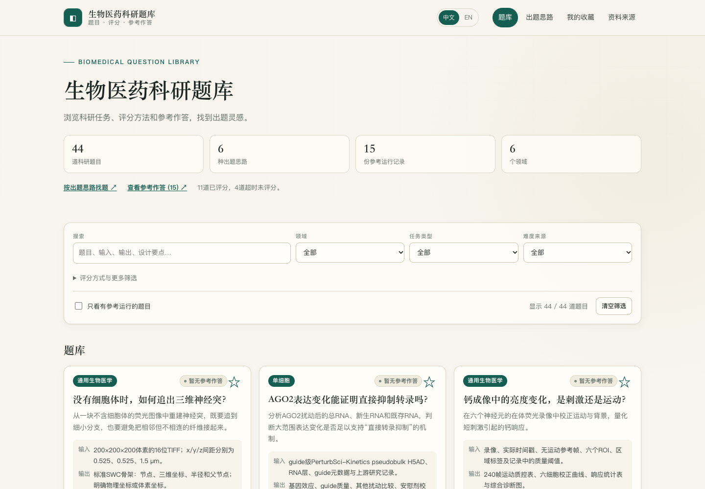
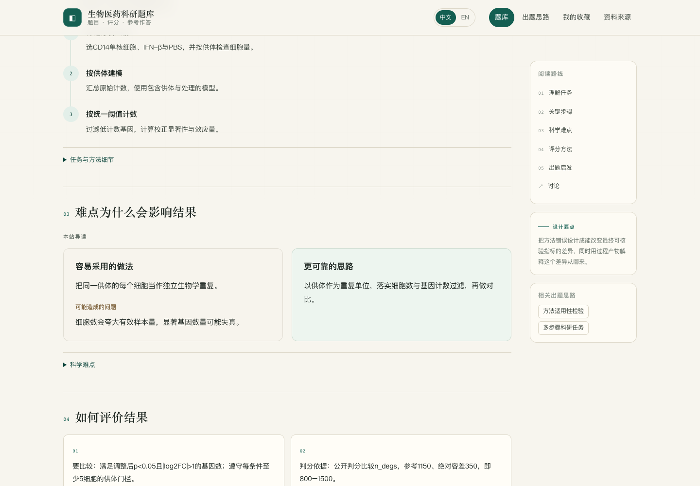
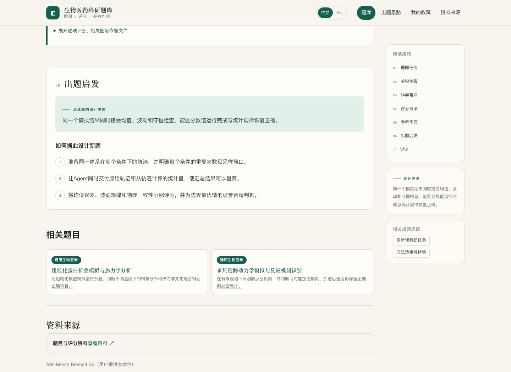

# BioTask Lens

**Biomedical research tasks, explained.**

[中文](README.md) · [Recommend a task](https://github.com/Wu-Junqi/biotask-lens/issues/new/choose) · [Discuss task design](https://github.com/Wu-Junqi/biotask-lens/discussions)

BioTask Lens connects the scientific question, inputs and outputs, key judgments, evaluation methods, and reference responses of representative biomedical research tasks. It helps researchers understand how a task is constructed and develop ideas for new evaluations.

**[Visit BioTask Lens →](https://biotask-lens.biotask-lens-app.workers.dev/#/tasks?lang=en)** · [中文网站](https://biotask-lens.biotask-lens-app.workers.dev/)

Use this repository to recommend tasks, share ideas, and suggest corrections.

## What you can learn

- **Understand the task:** the research question, available materials, and required outputs.
- **Understand the challenge:** a concrete scenario explaining the scientific judgment and its consequences.
- **Understand evaluation:** what is compared and where a reference response earns or loses credit.
- **Borrow the design:** data preparation, checkable deliverables, and meaningful assessment criteria.

The focus is individual task design and analysis. Reference agent runs illustrate concrete outcomes.

## Newly added public tasks

Added 23 tasks from [SciWorkBench](https://github.com/SKYEVAL-AIHub/SciWorkBench), [TxBench Antibody Development](https://github.com/latchbio/txBench-antibody-development), [TxBench Antibody Discovery](https://github.com/latchbio/txbench-antibody-discovery), [scBench](https://github.com/latchbio/scbench), and [SpatialBench](https://github.com/latchbio/spatialbench). Topics include neurite tracing, RNA mechanisms, imaging audits, structure elucidation, antibody decisions, and single-cell and spatial analysis.

Each includes bilingual explanations, the original prompt, assessment details, and design takeaways. Start with [neurite tracing](https://biotask-lens.biotask-lens-app.workers.dev/#/task/swb-neurite-tracing?lang=en) or [donor-aware differential expression](https://biotask-lens.biotask-lens-app.workers.dev/#/task/scbench-pseudobulk-differential-expression?lang=en).

## Example tasks

| Example | Research question | Design idea |
| --- | --- | --- |
| Stochastic calcium-channel simulation | How does channel count affect oscillation period and variability? | Assess means, fluctuations, and conservation together. |
| Gene regulatory-network inference | Who regulates whom, and with which sign? | Evaluate edges, directions, signs, and topology separately. |
| Active learning for biosensors | How can limited experiment rounds improve target response and selectivity? | Assess discovery and prediction of unmeasured variants. |

The current collection contains **44 tasks** and **15 reference-run records**: 11 scored runs and 4 unscored timeouts. The reference configuration is Qwen3.8 Max + Codex CLI; each task describes its configuration and score source.

Example: connecting a scientific challenge to its evaluation

Example: turning an existing task into a new design

## Contribute

- [Recommend a public task, paper, or workflow](https://github.com/Wu-Junqi/biotask-lens/issues/new?template=recommend-task.yml).
- [Describe a real research task](https://github.com/Wu-Junqi/biotask-lens/issues/new?template=task-idea.yml). Start with its question, inputs, and expected result.
- [Suggest a correction](https://github.com/Wu-Junqi/biotask-lens/issues/new?template=content-feedback.yml).
- [Discuss task design](https://github.com/Wu-Junqi/biotask-lens/discussions).

Ideas can be developed incrementally. Accepted contributions will be attributed to their sources and contributors. See [CONTRIBUTING.md](CONTRIBUTING.md).

## Follow updates

The website launch, representative cases, and content updates will be announced here. Star the project to bookmark it, and use GitHub Watch settings to select notifications.

Maintained by [Wu-Junqi](https://github.com/Wu-Junqi). Task write-ups retain attribution to their original sources and authors.
