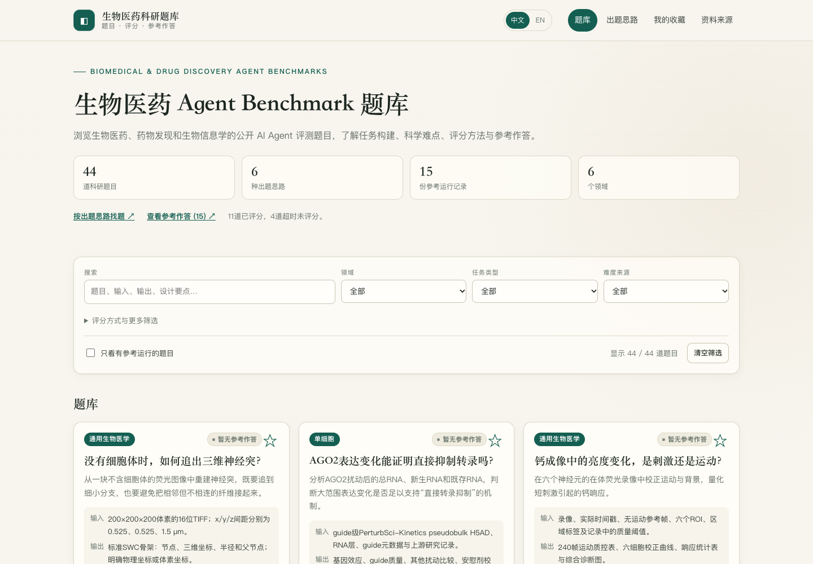
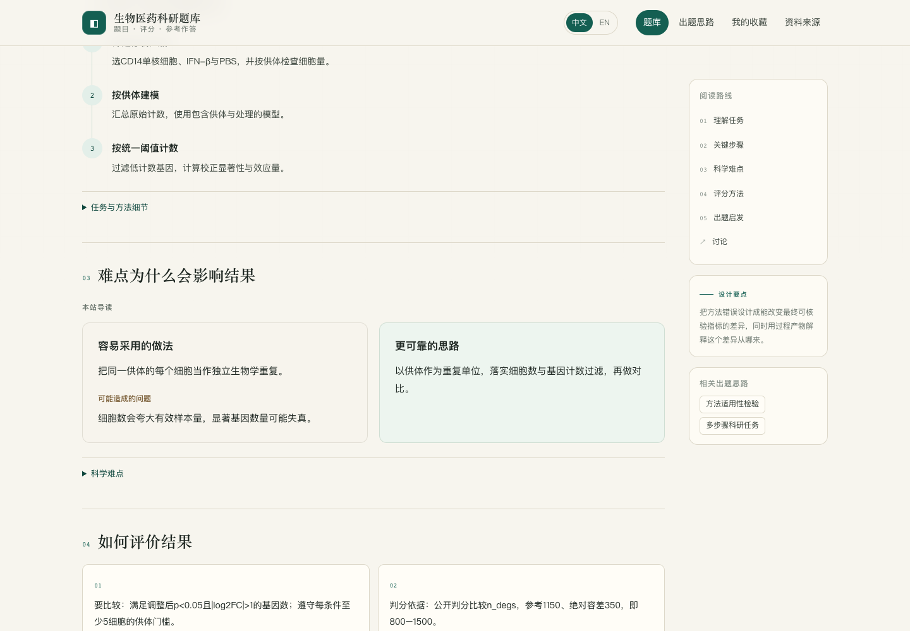
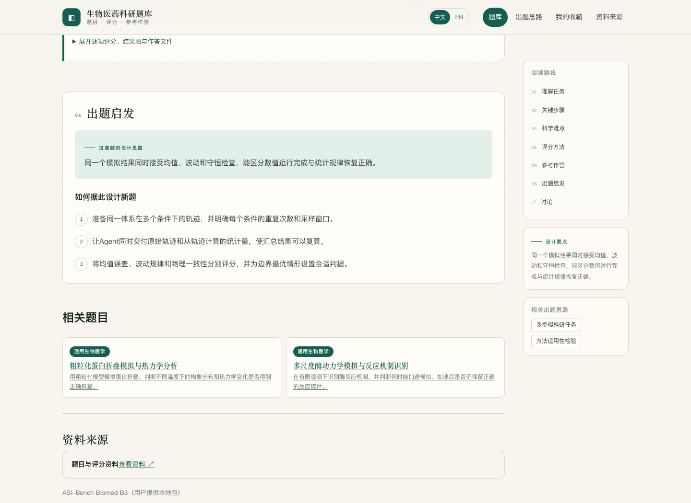

# BioTask Lens · 生物医药 Agent Benchmark 题库

**生物医药与药物发现 Agent 评测任务解析 · Biomedical & Drug Discovery Agent Benchmarks**

[English](README.en.md) · [推荐题目](https://github.com/Wu-Junqi/biotask-lens/issues/new/choose) · [交流出题思路](https://github.com/Wu-Junqi/biotask-lens/discussions)

BioTask Lens 收集生物医药（biomedical）、药物发现（drug discovery）和生物信息学领域的公开 AI Agent benchmark 题目。逐题解析科学问题、输入输出、关键判断、评分方法与参考作答，帮助研究者理解别人怎样出题，并获得设计新评测任务的思路。

**[访问 BioTask Lens →](https://biotask-lens.biotask-lens-app.workers.dev/)** · [English website](https://biotask-lens.biotask-lens-app.workers.dev/#/tasks?lang=en)

通过本仓库可以推荐题目、交流想法或反馈内容问题。

## 在这里可以学到什么

- **理解任务**：研究问题是什么，Agent得到什么材料，需要交付什么结果。
- **理解难点**：通过具体情境看清关键科学判断，以及它如何影响结果。
- **理解评价**：评分在比较什么，参考作答为什么得分或失分。
- **借鉴设计**：怎样准备数据、定义可检查的产物，并设计有意义的评价方法。

内容以单道任务的设计与分析为主线，参考Agent运行帮助说明具体表现。

## 新增公开题目

本轮新增23道，来自 [SciWorkBench](https://github.com/SKYEVAL-AIHub/SciWorkBench)、[TxBench抗体开发](https://github.com/latchbio/txBench-antibody-development)、[TxBench抗体发现](https://github.com/latchbio/txbench-antibody-discovery)、[scBench](https://github.com/latchbio/scbench) 和 [SpatialBench](https://github.com/latchbio/spatialbench)。覆盖三维神经突追踪、RNA机制判断、成像审计、谱图结构解析、抗体研发决策，以及单细胞和空间分析。

每题包含中英文导读、原始题面、评分方法与出题建议。可以从 [神经突追踪](https://biotask-lens.biotask-lens-app.workers.dev/#/task/swb-neurite-tracing) 或 [供体级差异表达](https://biotask-lens.biotask-lens-app.workers.dev/#/task/scbench-pseudobulk-differential-expression) 开始。

## 三个案例

| 案例 | 科学问题 | 可以借鉴的设计 |
| --- | --- | --- |
| 钙通道随机模拟 | 通道数量改变时，振荡周期和稳定性如何变化？ | 同时检查平均行为、随机波动和守恒。 |
| 基因调控网络推断 | 谁调控谁，是激活还是抑制？ | 将边、方向、符号及网络结构分别评价。 |
| 生物传感器主动学习 | 怎样在有限实验轮次中提高目标响应与选择性？ | 同时评价发现质量和未测变体的预测。 |

当前整理了 **44道任务**，附 **15份参考运行记录**：11份已评分、4份超时未评分。参考配置为 Qwen3.8 Max + Codex CLI；具体条件与评分来源在各题中说明。

查看示意情境：把科学难点与评分联系起来

查看出题启发：从一个案例迁移到新题目

## 欢迎参与

- **发现一道值得介绍的题目？** [推荐公开题目、论文或管线](https://github.com/Wu-Junqi/biotask-lens/issues/new?template=recommend-task.yml)。
- **在研究中遇到一个有价值的Agent任务？** [提供任务梗概](https://github.com/Wu-Junqi/biotask-lens/issues/new?template=task-idea.yml)。问题、输入和预期结果先讲清楚即可。
- **发现介绍或评分解释有问题？** [反馈内容问题](https://github.com/Wu-Junqi/biotask-lens/issues/new?template=content-feedback.yml)。
- **想讨论出题方法？** [到Discussions交流](https://github.com/Wu-Junqi/biotask-lens/discussions)。

任务线索可以逐步完善。采纳的贡献会注明来源与贡献者。具体参与方式见 [贡献说明](CONTRIBUTING.md)。

## 更新与关注

网站上线地址、代表案例和内容更新会在本仓库公布。可以通过 Star 收藏项目，并在 GitHub 的 Watch 设置中选择希望接收的通知。

维护者：[Wu-Junqi](https://github.com/Wu-Junqi)。题目导读保留原始来源，原题及研究成果归其原作者。
